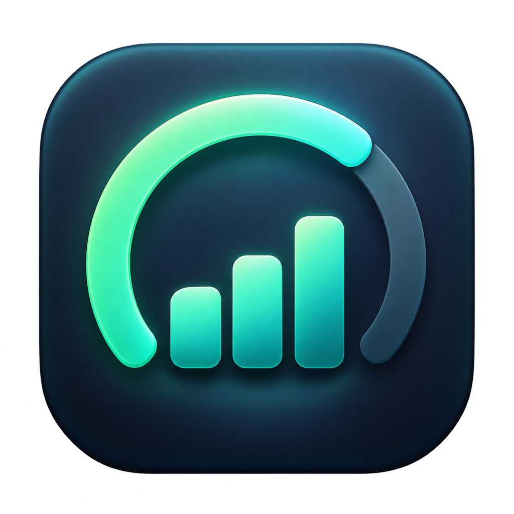

<p align="center">
  
</p>

<h1 align="center">Codex Meter</h1>

<p align="center"><strong>在 macOS 菜单栏查看 Codex 余量、重置时间、模型用量与费用估算。</strong></p>

<p align="center">原生 Swift 应用 · 简体中文 / English · Apple 芯片与 Intel · MIT 开源</p>

<p align="center">
  <a href="#中文介绍">简体中文</a> ·
  <a href="#english">English</a> ·
  <a href="https://github.com/ooeooo/codex-meter/releases/latest">下载最新版</a> ·
  <a href="https://github.com/ooeooo/codex-meter/issues">问题反馈</a>
</p>

<p align="center">
  <a href="https://github.com/ooeooo/codex-meter/releases/latest"></a>
  <a href="https://www.swift.org/"></a>
  <a href="LICENSE"></a>
  <a href="https://github.com/ooeooo/codex-meter/releases/latest"></a>
</p>

## 中文介绍

Codex Meter 是一款免费、开源的 macOS 菜单栏应用，用于查看 **Codex 还剩多少可用额度、何时重置，以及本地记录的模型与 token 用量**。应用直接使用本机 Codex 的用量服务和已有登录状态；首次使用默认账号时，不需要创建额外的 Meter 账号，也不需要 API Key。

支持独立的 `Codex.app`，以及集成 Codex 的新版 `ChatGPT.app`。即使本机没有独立的 `/Applications/Codex.app`，也可以使用 `ChatGPT.app` 内置的 Codex 服务，**无需另外安装 CLI**。

### 主要功能

- **余量与重置时间**：菜单栏显示各配额窗口中最低的剩余比例，展开后可分别查看各窗口和重置时间。
- **用量趋势**：七天 token 活动图表、按模型统计的本地用量，以及适用窗口的每周使用进度。
- **费用估算**：根据内置的模型标准 API 价格估算，支持 USD、AUD 和 EUR。
- **自动刷新与提醒**：每两分钟刷新配额，支持手动重试、低余量提醒和登录时启动。
- **中文界面**：支持简体中文和英文，默认跟随系统语言，可在设置中即时切换并保存选择。
- **账号管理**：支持浏览器登录添加独立账号，并选择仅切换 Meter 视图或同时切换 Codex 桌面账号。
- **错误诊断**：显示不可用或过期状态，支持复制经过凭据脱敏的诊断信息及手动选择 Codex 应用。
- **脚本支持**：安装包附带可选的 `codex-meter` 命令行工具，提供稳定的英文文本、JSON 和余量阈值退出码。

> 费用显示为 **API 等价估算**，不代表 ChatGPT 订阅账单或实际扣费。

### 系统与支持范围

| 项目 | 支持情况 |
| --- | --- |
| 操作系统 | macOS 13 Ventura 或更新版本 |
| 芯片 | Apple silicon（M 系列）与 Intel，提供通用安装包 |
| Codex 来源 | 已登录、带有 Codex 用量服务的 `Codex.app` 或新版 `ChatGPT.app`；也可使用本机 CLI |
| 桌面服务布局 | 兼容旧版 `Contents/Resources/codex` 与新版 `Contents/Resources/codex-cli/` |
| 界面语言 | 简体中文、英文；支持跟随系统语言 |
| 账号要求 | Codex 服务能够返回该账号的配额信息 |
| 实现与依赖 | 使用 Swift 6 和 Apple 系统框架构建；运行时使用本机 Codex 服务，无第三方 Swift 包依赖 |

当前提供 macOS 应用和命令行工具；WidgetKit 小组件仍在规划中。详见 [小组件路线图](docs/widget-roadmap.md)。

### 下载与安装

1. 前往 [GitHub Releases](https://github.com/ooeooo/codex-meter/releases/latest)，下载最新的 `Codex-Meter-*.zip`。发布页面也提供对应的 SHA-256 校验文件。
2. 解压，将 **Codex Meter.app** 放入 `/Applications`。升级时先退出旧版，再替换应用。
3. 打开 Codex Meter，点击菜单栏图标查看用量。应用使用本机 Codex 的已有登录状态。
4. 如需手动切换中文，展开 **Settings（设置）**，在 **Language（语言）** 中选择 **简体中文**。

当前社区安装包采用 ad-hoc 签名，尚未经过 Apple 公证。如果 macOS 阻止首次打开，从本仓库下载并确认来源后，可在 **系统设置 → 隐私与安全性 → 仍要打开** 中允许该应用。参见 [Apple 官方说明](https://support.apple.com/102445)。

### 使用帮助

**已经安装 ChatGPT / Codex，却提示找不到用量服务？**

在用量区点击 **选择 Codex 应用…**，选择整个 `/Applications/ChatGPT.app` 或实际安装的 `Codex.app`，不要选择内部的 `.framework` 组件。应用会保存位置，并用当前账号重新读取配额。若仍异常，点击 **重试** 后使用 **复制诊断信息**。

**菜单栏百分比与某个用量窗口不一样？**

菜单栏取各配额窗口中最低的剩余比例。展开 **配额窗口** 可分别查看，不能将该汇总值与单个窗口直接比较。

**切换账号会退出桌面应用的登录吗？**

选择 **Meter Only（仅用量计）** 只切换用量视图；选择 **Meter + Codex（用量计 + Codex）** 会退出 Codex 桌面账号并打开 OpenAI 浏览器登录流程。密码、SSO 和验证码由浏览器与 Codex 处理。

**哪些数据会被读取？**

配额通过本机 `codex app-server` 从官方服务获取；本地历史只保留模型、时间和 token 汇总，提示词、回答和工具内容不进入统计结果。图表来自本机默认 `~/.codex` 日志，不代表云端、其他设备或所选账号的完整历史。Meter 不直接读取或复制登录令牌，添加与切换账号的凭据由 Codex 管理。本地历史不会上传到额外的分析服务。详见 [隐私说明](docs/privacy.md) 和 [架构说明](docs/architecture.md)。

### 中文支持与问题反馈

欢迎使用 **中文或英文** 在 [GitHub Issues](https://github.com/ooeooo/codex-meter/issues) 提交问题或建议。报告读取故障时，请附上应用版本、macOS 版本、ChatGPT / Codex 版本、复现步骤和错误提示；需要诊断时，可附上应用中的 **复制诊断信息**，并去掉不希望公开的用户名、邮箱或本地路径。请勿提交登录凭据或原始会话内容。

- [版本更新记录](docs/changelog.md)
- [命令行工具参考](docs/cli.md)
- [GitHub Actions 构建与发布](docs/build-and-release.md)
- [参与贡献](CONTRIBUTING.md)
- [安全问题报告方式](SECURITY.md)

## English

<p align="center">
  
</p>

**Your Codex limits, reset times, model usage and local cost estimate—right in the macOS menu bar.**

Codex Meter is a free, open-source macOS menu bar app that shows how much Codex usage you have left, when it resets, which models used it, and what that activity would cost at standard API rates.

I built this because I wanted one simple answer sitting in the menu bar: **how much Codex do I have left?** I did not want fake estimates, a web account, an Electron app or another service collecting usage data.

> Cost is always labelled as an **API-equivalent estimate**. It is not presented as your ChatGPT subscription bill.

## At a glance

| Quota | Local insight | Cost | Automation |
| --- | --- | --- | --- |
| Remaining percentage | Seven-day native chart | Official per-model rates | Universal CLI |
| Exact reset time | Model-by-model usage | USD, AUD or EUR | JSON output |
| Honest stale/error state | Prompts stay ignored | Unknown models stay unpriced | Threshold exit codes |

## Why Codex Meter is different

### Honest when data fails

If Codex cannot return a current limit, Codex Meter says it is unavailable. It never leaves a stale percentage looking current and never invents a reset estimate.

### Open enough to trust

The complete Swift source, local-log parser, build scripts and release automation are public. You can inspect exactly what the app reads and verify that it does not copy credentials or transmit local history.

### A true one-job Mac app

No Electron runtime, analytics SDK or external database. The native app uses a local Codex app-server process, polls quota every two minutes and automatically scans local activity every ten minutes; startup and profile changes can also trigger a scan.

### Power without a privacy trade-off

Alert thresholds, menu-bar modes, history charts, cost rates and CLI automation stay on your Mac. No separate API key or third-party Swift package is required. The app uses the existing Codex service and macOS system tools.

## Features

- Includes a native macOS application icon with standard and Retina sizes.
- Supports English and Simplified Chinese, following the system language by default, with an instant language switch in Settings.
- Shows the most constrained Codex allowance directly in the macOS menu bar.
- Shows weekly pace against an even seven-day allowance, with a compact reset, percentage and pace badge.
- Breaks down every available usage window with a percentage and local reset time.
- Refreshes automatically every two minutes, with manual refresh when you want it.
- Warns you when remaining usage drops below 10%, 20%, or 30%.
- Detects stale or unavailable data instead of leaving a misleading old number visible.
- Uses the existing default Codex sign-in without requiring a separate Meter profile, and offers sanitized copyable diagnostics when refresh fails.
- Builds a seven-day token activity chart from aggregate events in local Codex session logs.
- Breaks local usage down by the actual model recorded for each Codex turn.
- Automatically calculates an API-equivalent estimate with bundled official OpenAI standard prices.
- Displays estimates in USD, AUD or EUR with a dated local ECB reference-rate snapshot.
- Adds accounts through OpenAI's secure browser login, then hot-swaps profiles from the account menu beside refresh.
- Asks whether each profile change should affect Meter only or Meter plus the Codex desktop app.
- For a desktop swap, signs Codex out through the official app-server method, completes OpenAI's browser login, verifies the account and relaunches Codex.
- Deletes unused local account profiles and their saved Codex credentials with confirmation, including stale records whose folder is already gone.
- Shows OpenAI's real banked-reset count when the account returns it, and celebrates reset, savings and token milestones.
- Switches between icon + percentage, reset + percentage, percentage-only, icon-only and activity-chart menu-bar modes.
- Includes a universal `codex-meter` CLI with stable text/JSON output and threshold exit codes.
- Supports launch at login without adding a Dock icon.
- Keeps usage windows, activity, accounts and settings collapsible so the popover stays calm.
- Works natively on Apple silicon and Intel Macs.

## Download and install

1. Download the latest `Codex-Meter-*.zip` from [GitHub Releases](https://github.com/ooeooo/codex-meter/releases/latest).
2. Unzip it and move **Codex Meter.app** into `/Applications`.
3. Open it once. The gauge and remaining percentage will appear in your menu bar.

The ZIP also includes the optional `codex-meter` command-line tool and an installation note.

The current community build is ad-hoc signed, not Apple-notarized. If macOS blocks an app downloaded from this repository, open **System Settings → Privacy & Security → Open Anyway** after the first launch attempt, then confirm. See [Apple’s instructions](https://support.apple.com/102445).

### Interface language

The interface follows the system language by default. Open **Settings → Language** to choose **Simplified Chinese** or **English** immediately; the choice is saved. Usage, charts, settings, account dialogs, notifications and common errors are localized. CLI text remains English with stable JSON output for scripts.

The native ICNS icon is built from the PNG source with macOS `sips` and `iconutil`; PNG and ICO assets are included in `Resources/`.

### Requirements

- macOS 13 Ventura or newer
- ChatGPT/Codex installed and signed in
- A Codex plan that returns rate-limit information

Codex Meter uses the usage service bundled with the installed Codex desktop app; a separate CLI installation is not required. It supports both the legacy `Contents/Resources/codex` layout and the newer `Contents/Resources/codex-cli/` package. It finds the running or registered official desktop app, checks `/Applications` and `~/Applications`, and supports absolute PATH, Homebrew, npm, Volta, and local CLI locations. The current unified ChatGPT desktop uses the Codex bundle identity; the classic ChatGPT app does not provide a Codex service. Developers launching from Terminal can also set `CODEX_PATH` to an absolute Codex executable path.

Codex Meter keeps each saved profile in an isolated `CODEX_HOME`. When you choose **Meter + Codex**, it uses OpenAI's documented `account/logout` and ChatGPT browser-login flow against the default Codex profile, verifies that login, then relaunches the desktop app. OpenAI does not publish a direct account-switch deep link, so a browser confirmation is required; Codex Meter never asks for or handles your password or MFA code.

## Troubleshooting quota reads

If the desktop usage service cannot be found, click **Select Codex App…** and select the installed `Codex.app` or unified `ChatGPT.app`. Meter remembers the app location and retries with the same account. It validates the Codex bundle identity and its bundled service; selecting the classic ChatGPT app or an app without that service is rejected. This does not install a CLI, modify the desktop app or change its login.

For other quota errors, use **Try again**, then **Copy Diagnostics** in the usage section. The diagnostic text shows the selected executable, effective Codex data directory, protocol stage and sanitized process errors; unresolved executables also include searched paths. It does not read or copy login credentials. Finder does not inherit shell-only `CODEX_PATH`, `CODEX_HOME`, proxy or CA settings; a Terminal launch with those variables may therefore use a different account or network configuration.

The menu bar shows the lowest remaining percentage across returned windows; expand the usage section to inspect each window. Build checks use offline protocol fixtures. Your signed-in account and network environment still need to work on your own Mac.

## Privacy by design

This app has one job and does not need your data for anything else.

- No analytics
- No ads
- No tracking
- No extra network service
- Meter does not read or copy login credentials; Codex manages credentials for explicitly added profiles
- No uploaded session history

Codex Meter starts the local `codex app-server` process and calls its read-only `account/rateLimits/read` method. Codex handles quota requests through its official service using the existing login. Explicit account additions and desktop account switches use OpenAI's browser login flow and Codex's authentication methods. For history, Meter prefilters `turn_context` and `token_count` lines from local rollout logs, then a narrow decoder retains only model IDs, timestamps and cumulative numeric totals; prompts, responses and tool payload fields are ignored. It never reads `~/.codex/auth.json` and never calls the rate-limit reset action. See [Privacy](docs/privacy.md) and [Architecture](docs/architecture.md) for the full data flow.

## CLI and scripting

```sh
# Human-readable limit status
codex-meter status

# Stable JSON for Shortcuts, jq or scripts
codex-meter status --json

# Exit 2 when the tightest window reaches 20% or lower
codex-meter status --threshold 20

# Seven days of local token activity
codex-meter history --days 7 --json

# Show the model breakdown and estimates in Australian dollars
codex-meter history --days 7 --currency AUD
```

Known models are priced automatically using a bundled snapshot of official standard API rates. Optional flags provide a fallback for unknown future models:

```sh
codex-meter history --days 30 \
  --input-rate 2.00 \
  --cached-input-rate 0.50 \
  --output-rate 8.00
```

The result includes each model's token total, share, pricing status and estimate. USD is the base price; AUD and EUR conversion uses a dated [European Central Bank reference-rate snapshot](https://www.ecb.europa.eu/stats/policy_and_exchange_rates/euro_reference_exchange_rates/html/index.en.html). It is labelled **API-equivalent estimate**—not ChatGPT subscription spend. The bundled price snapshot is dated and linked to the [official OpenAI model catalogue](https://developers.openai.com/api/docs/models); long-context, regional, priority, batch, flex and tool-call adjustments are not inferred from local aggregate logs. See the full [CLI reference](docs/cli.md).

## Build it yourself

You need the macOS Swift toolchain.

```sh
git clone https://github.com/ooeooo/codex-meter.git
cd codex-meter
SKIP_LIVE_CODEX_CHECK=1 ./scripts/test.sh
./scripts/build-app.sh
open "dist/Codex Meter.app"
```

Run `./scripts/test.sh` without the environment variable when Codex is installed and signed in to include the live integration check.

GitHub Actions can build the app without a local Mac. CI uploads downloadable development packages and also supports **Actions → CI → Run workflow**. Version tags trigger tested releases with ZIP downloads and SHA-256 checksums; existing tags can also be released manually. See [Build and release with GitHub Actions](docs/build-and-release.md) for instructions.

## Why open source?

A usage meter should be easy to inspect and easy to trust. You can see exactly what Codex Meter runs, how it reads the percentage, what it stores, and what it does not touch.

If you find a bug or have a practical improvement, [open an issue](https://github.com/ooeooo/codex-meter/issues) or read [CONTRIBUTING.md](CONTRIBUTING.md).

## Widget status

The data layer is ready for a future macOS widget, but the public ad-hoc build does not claim WidgetKit support yet. Reliable widgets require an Apple team-bound App Group, separately signed extension and notarized distribution. Shipping a half-working widget would break the same honest-error promise this app is built around. The exact production path is documented in [Widget roadmap](docs/widget-roadmap.md).

## Project status

Codex Meter tracks the local Codex app-server interface and local rollout aggregate format. These can change between Codex versions, so compatibility fixes may be needed as Codex evolves. Errors are shown honestly rather than replaced with estimated quota data.

## License

MIT licensed. Free to use, modify, and share. See [LICENSE](LICENSE).

---

Built and maintained by [Jhye / The Jhye Factor](https://github.com/TheJhyeFactor).

> Codex Meter is an independent community project. It is not affiliated with, endorsed by, or sponsored by OpenAI. Codex and OpenAI are trademarks of their respective owners.
